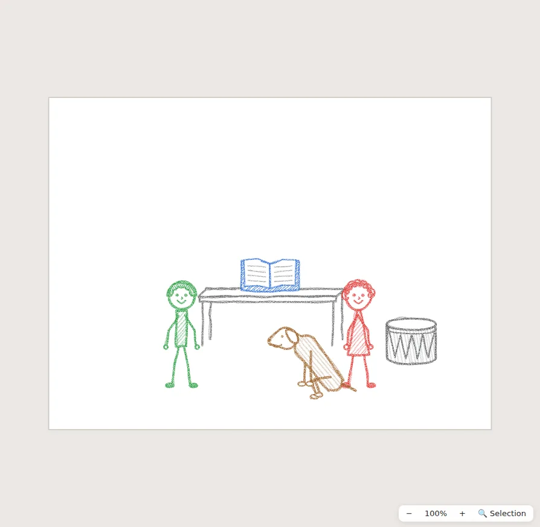
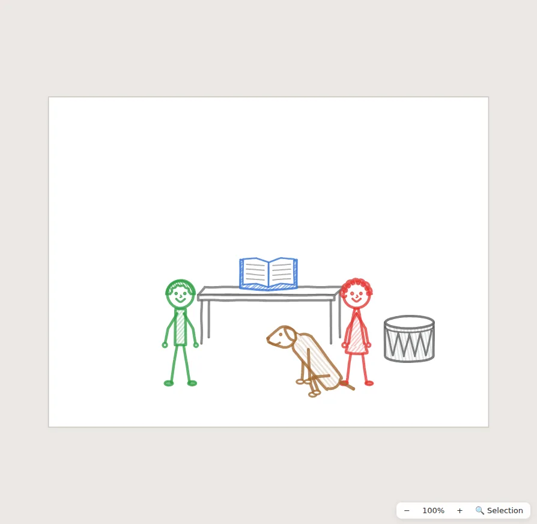
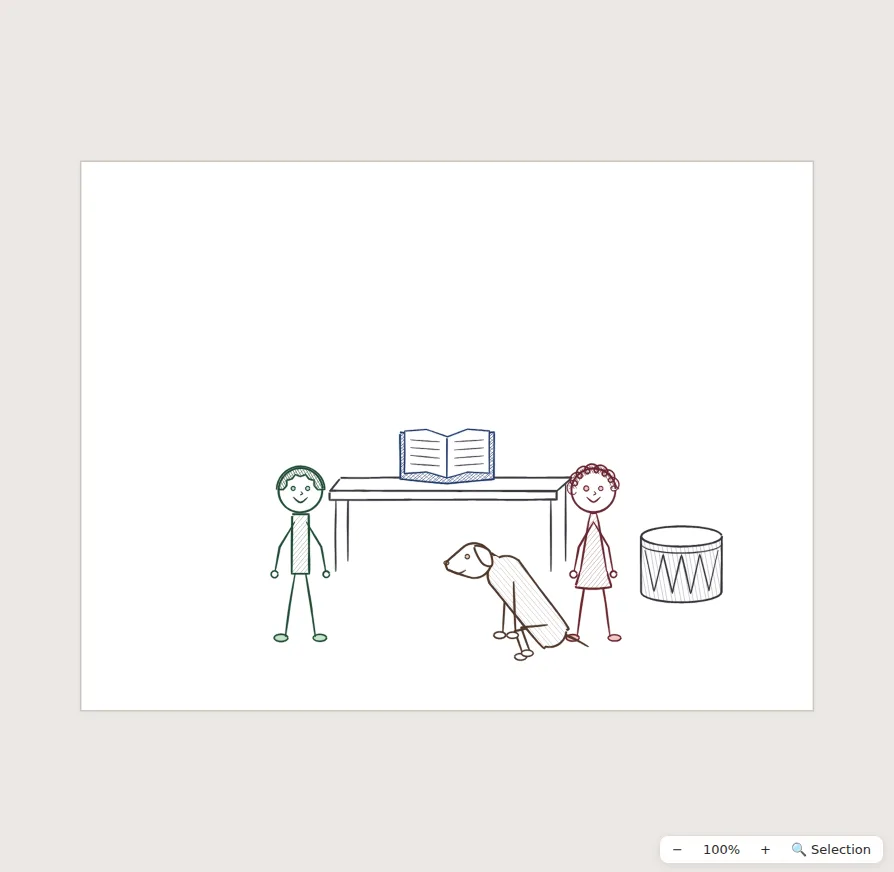
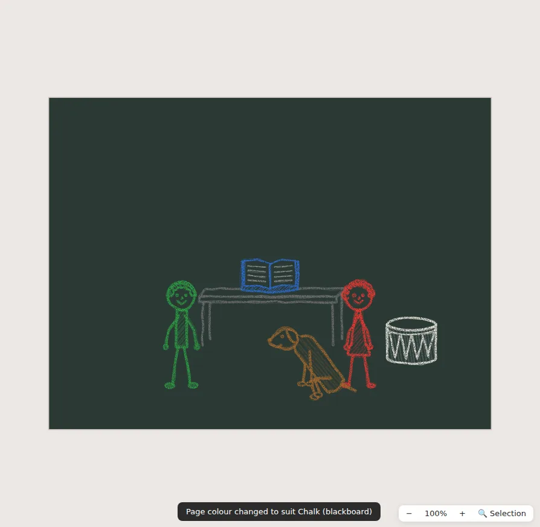
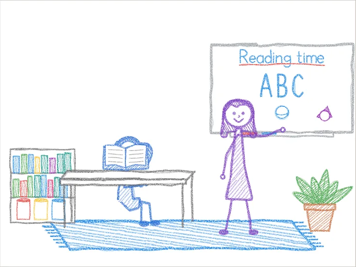
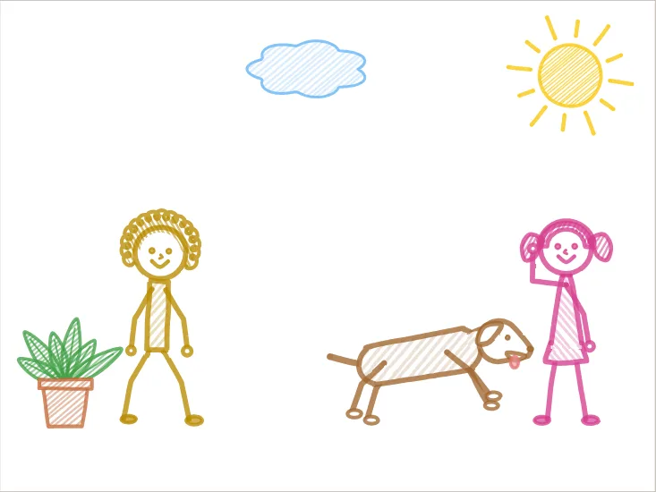
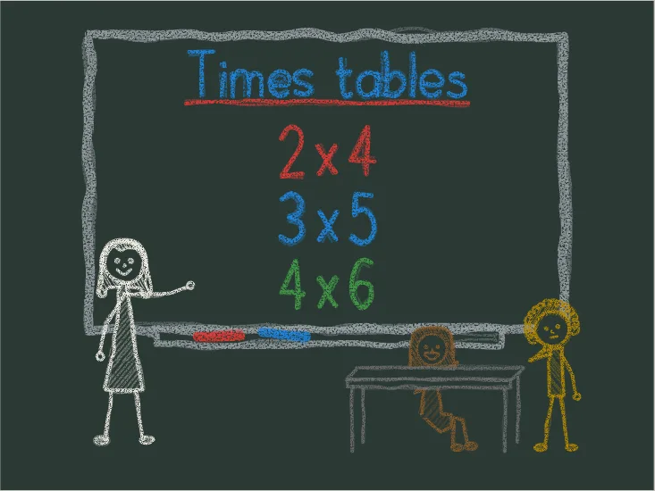
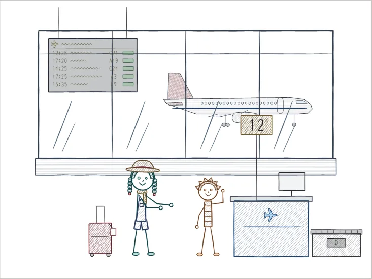

# StorySketch

Pose stick-figure characters and props, layer them on a page, and export them in a hand-drawn style — **crayon, marker, ink pen or chalk**.
Built for picture books, worksheets and classroom materials, but it is a general scene-posing tool. No account, no server, no build step:
open `index.html` in Chrome or Edge and start. Your work is a plain JSON file you keep.

| Crayon | Marker | Ink pen | Chalk |
|---|---|---|---|
|  |  |  |  |

## Samples
**New → Sample projects** opens ready-made scenes to look at and take apart: a busy classroom, pets and a dinosaur, a chalkboard lesson, an airport.

| Classroom (crayon) | Pets and dinosaurs (marker) |
|---|---|
|  |  |
| **Chalkboard (chalk)** | **Airport (ink pen)** |
|  |  |

## What you can do
- **Pose** people and animals by dragging handles (hands, feet, elbows, knees, head, tail…). Preset poses for each skeleton, mirror, bend flip.
- **Characters** are defined once and reused everywhere: colour, hair, clothes, accessories, build. Change Lily once, she changes on every page.
- **Layer** things so a table hides a child's legs, or a child's hands sit on top of a drum. Group, lock, zoom, multi-select.
- **Props**: about 100 — classroom, art room, airport, furniture, pictures children draw, a whiteboard that writes crayon handwriting.
- **Styles**: draw clean while editing; export as crayon, marker, ink or chalk (same scene, same result every time). Chalk suggests a blackboard page.
- **Animals**: a four-legged skeleton gives a dog, a cat and a dinosaur ([see them](docs/animals.webp)); new skeletons are plugins.
- **Export** PNG or SVG: the page, a selection, or every layer.

## Run it
```bash
git clone <this repo> && cd storysketch
# either open index.html in Chrome/Edge directly (works from disk), or:
python3 -m http.server 8765      # then browse to http://localhost:8765
```
Save your work with **Save as…** (Chrome/Edge keep the file for **Save** / Ctrl+S). The browser autosave is only a convenience.
Quick-start tips are in [`docs/USING.md`](docs/USING.md).

## Everything is a plugin
Hair, clothes, accessories, props, characters, poses, templates, **drawing styles, skeletons (rigs)** and sample projects are all files in
[`plugins/`](plugins/README.md). Copy one, change its `id`, add the file, rescan. A style is ~60 lines; a new skeleton (a bird, a robot) is one file.

## Develop
```bash
npm install            # only for the browser tests (playwright-core); the unit tests need nothing but Node 20+
npm test               # unit tests (node --test) — styles, registry, project files, both skeletons, every plugin
npm run test:e2e       # headless-Chromium smoke tests
npm run check:plugins  # plugins/manifest.js is up to date
```
How it fits together: [`docs/ARCHITECTURE.md`](docs/ARCHITECTURE.md). Contributing: [`CONTRIBUTING.md`](CONTRIBUTING.md). History: [`CHANGELOG.md`](CHANGELOG.md).

## Hosted edition
The open-source tool stays fully local. A hosted edition (accounts, online assets, a searchable community gallery) is planned on top of it;
the seams for that — storage adapters and asset sources — are in the core already: [`docs/HOSTED-EDITION.md`](docs/HOSTED-EDITION.md).

## License
MIT — see [LICENSE](LICENSE).
